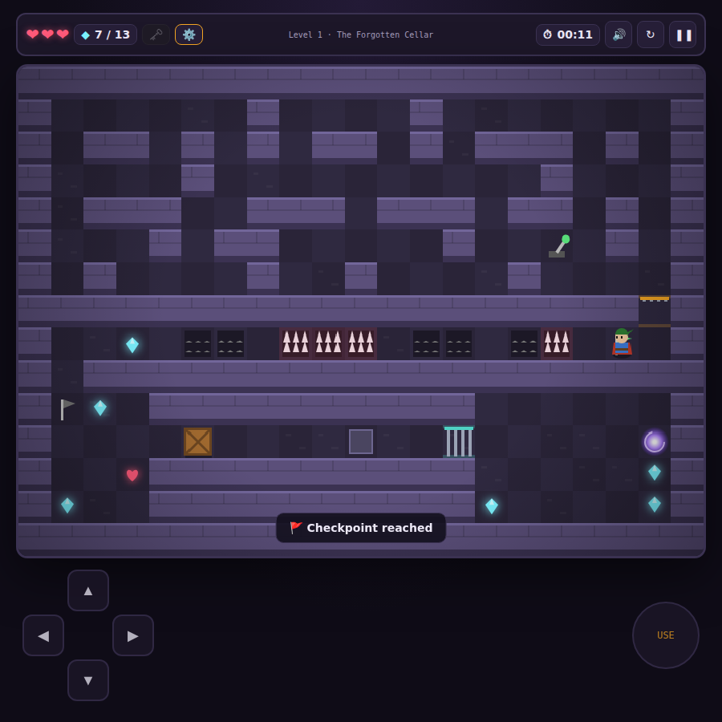
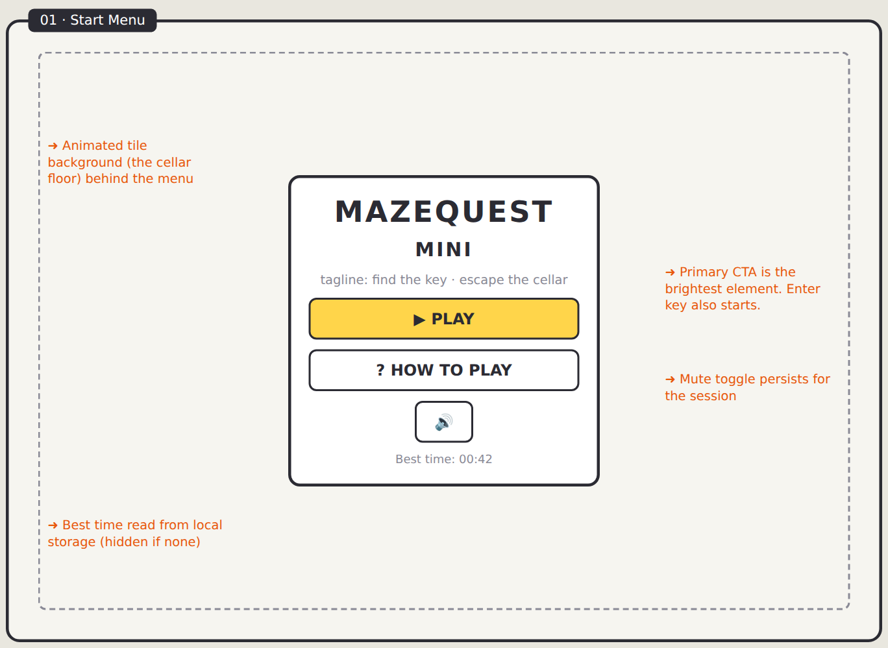
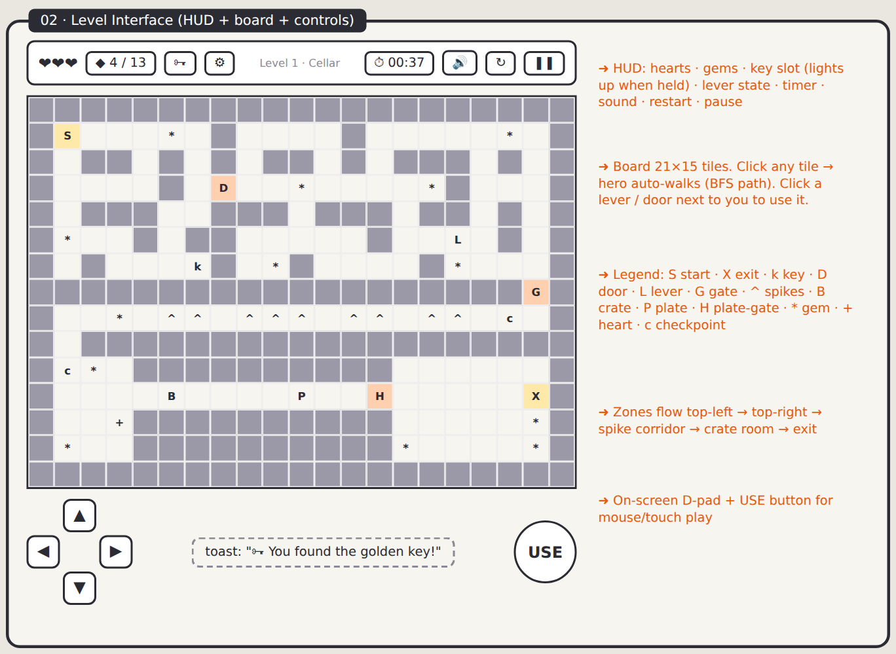
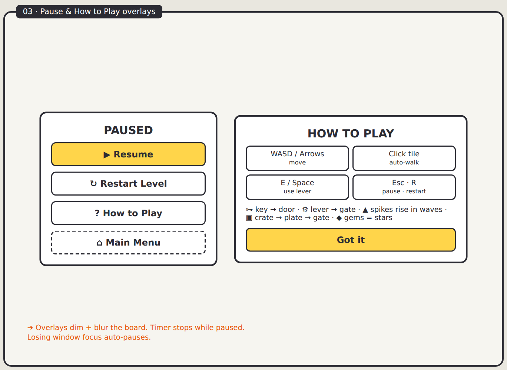
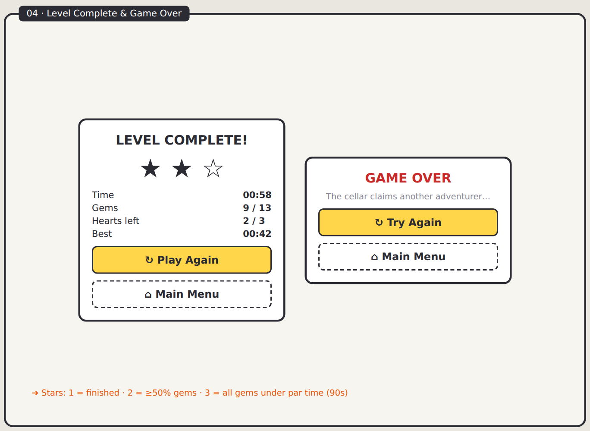
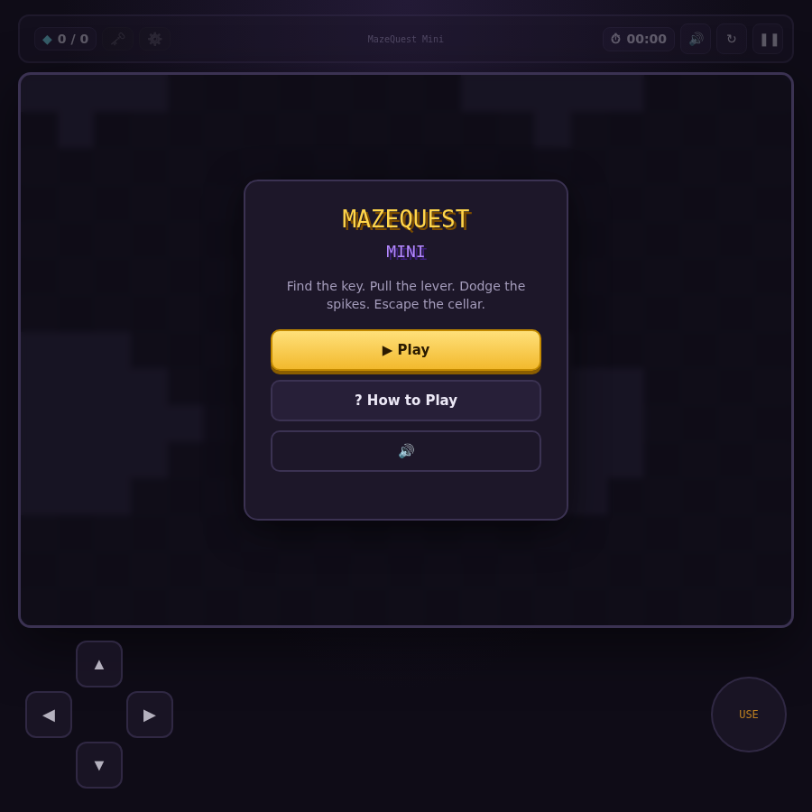
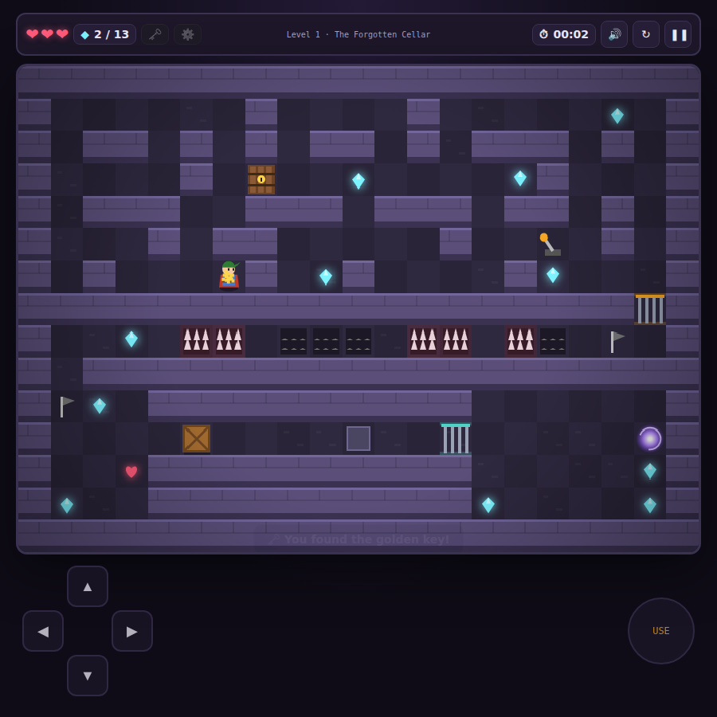
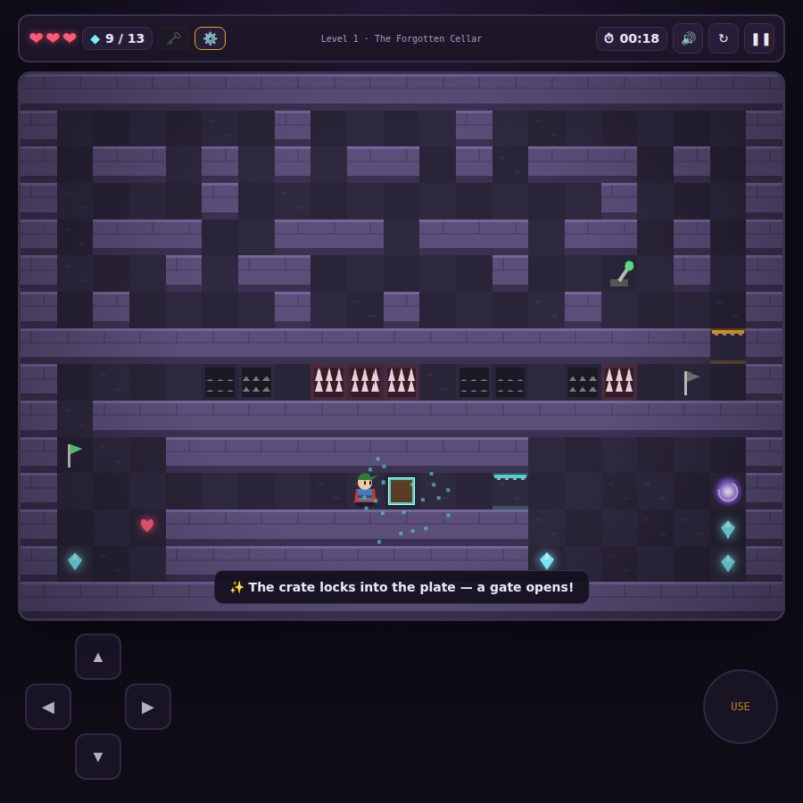
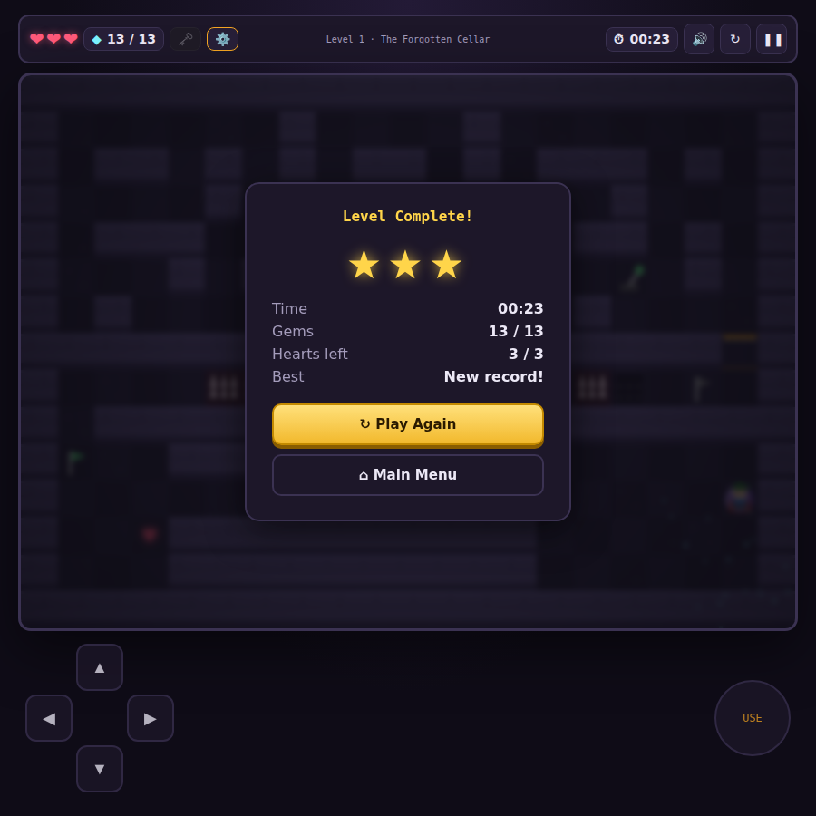

# 🗝️ MazeQuest Mini

A mini top-down puzzle adventure. Find the key, pull the lever, dodge the spikes, push the crate, and escape **The Forgotten Cellar**.

Built with HTML5 Canvas + vanilla JavaScript: no frameworks, no build step, no image or audio files.



## ▶ Play

- **Online:** enable GitHub Pages (Settings → Pages → Branch `main` / root) and open `https://<your-user>.github.io/mazequest-mini/`
- **Locally:** just open `index.html` in any modern browser (or `npm start` to serve it).

## 🎮 Controls

| Action | Keyboard | Mouse | Touch |
|---|---|---|---|
| Move | WASD / Arrow keys | Click a tile (auto-walk) | D-pad |
| Use lever | E / Space | Click the lever | USE |
| Pause | Esc / P | ❚❚ | ❚❚ |
| Restart | R | ↻ | ↻ |

## 🧩 What's in the first release

| Requirement | Delivered |
|---|---|
| One maze level with clear start & exit | 21×15 level, start tile → glowing exit portal |
| ≥ 3 puzzles / obstacles | **4**: key → locked door · lever → iron gate · timed spike traps · crate → pressure plate → gate |
| Collectibles | 13 gems, a heart pickup, 2 checkpoints, 3-star rating, best time |
| Controllable character | 4-direction grid movement with smooth tweening, facing, walk animation |
| Collision | Walls, doors, gates, levers, crates |
| Interactive objects | Respond to movement **and** clicks |
| Clickable UI | Start menu, How to Play, HUD, Pause, Level Complete, Game Over |

## 📁 Repository structure

```
mazequest-mini/
├── PRD.md                  ← Product Requirements Document
├── index.html              ← UI: menus, HUD, overlays, on-screen controls
├── css/style.css
├── js/level1.js            ← level data (ASCII map + legend)
├── js/game.js              ← engine: input, movement, puzzles, rendering, audio
├── docs/
│   ├── mockups/            ← UI wireframes (PNG + editable HTML source)
│   └── screenshots/        ← screenshots from the real build
└── tests/playthrough.mjs   ← automated end-to-end playthrough (Playwright)
```

## 🖼️ UI mockups

| Start menu | Level interface |
|---|---|
|  |  |
| **Pause / How to play** | **Win / Game over** |
|  |  |

## 📸 Screenshots (actual build)

| Start menu | Key found | Crate puzzle | Level complete |
|---|---|---|---|
|  |  |  |  |

## ✅ Tests

```bash
npm install
npx playwright install chromium
npm test
```

The script plays the whole level: collects the key, opens the door, pulls the lever, times the spike corridor, pushes the crate onto the plate, collects all 13 gems, checks pause, and reaches the exit. It fails on any runtime error.

## ✏️ Making new levels

Levels are plain strings in `js/level1.js`:

```
#  wall     .  floor    S  start    X  exit
k  key      D  door     L  lever    G  lever gate
^  spikes   B  crate    P  plate    H  plate gate
*  gem      +  heart    c  checkpoint
```

See [PRD.md](PRD.md) for the full design, requirements, and roadmap.

## License

MIT
